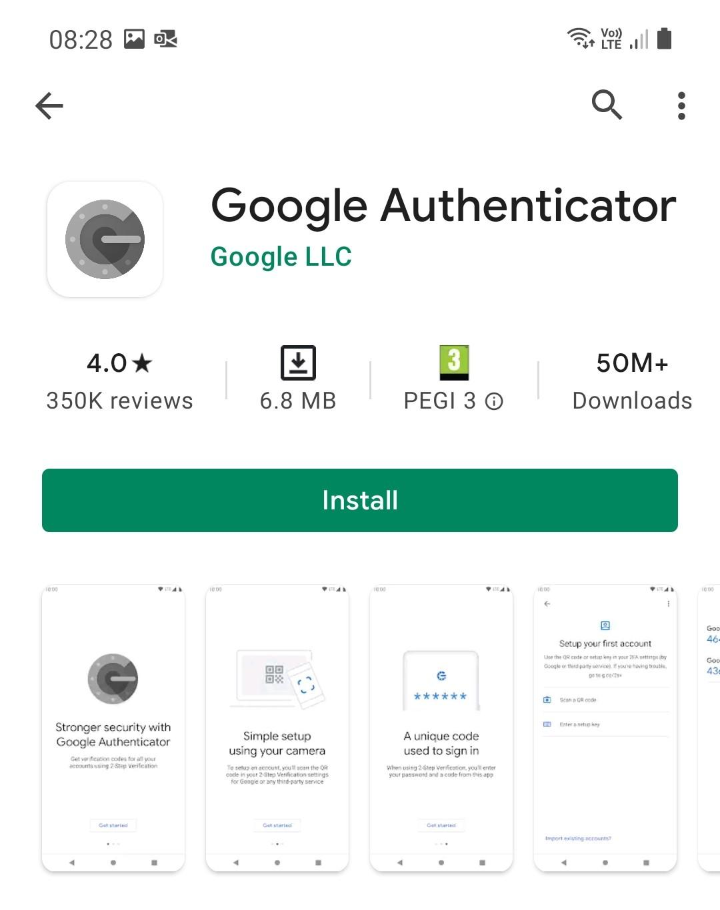
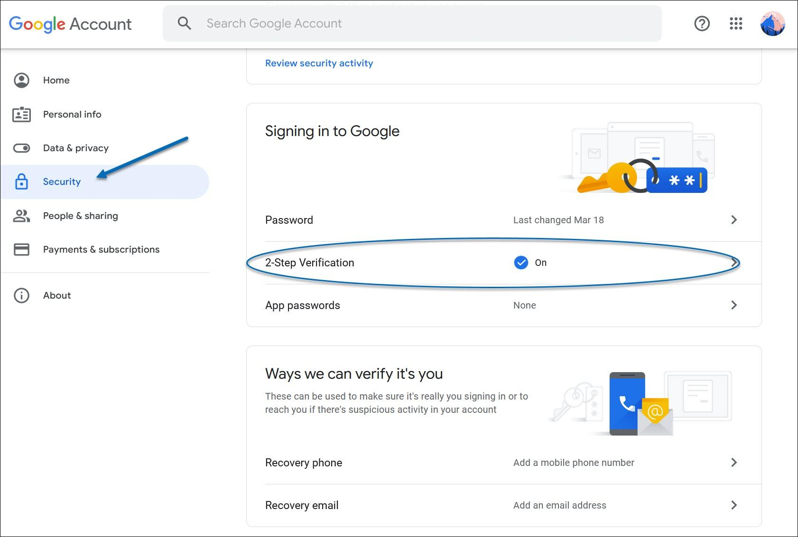
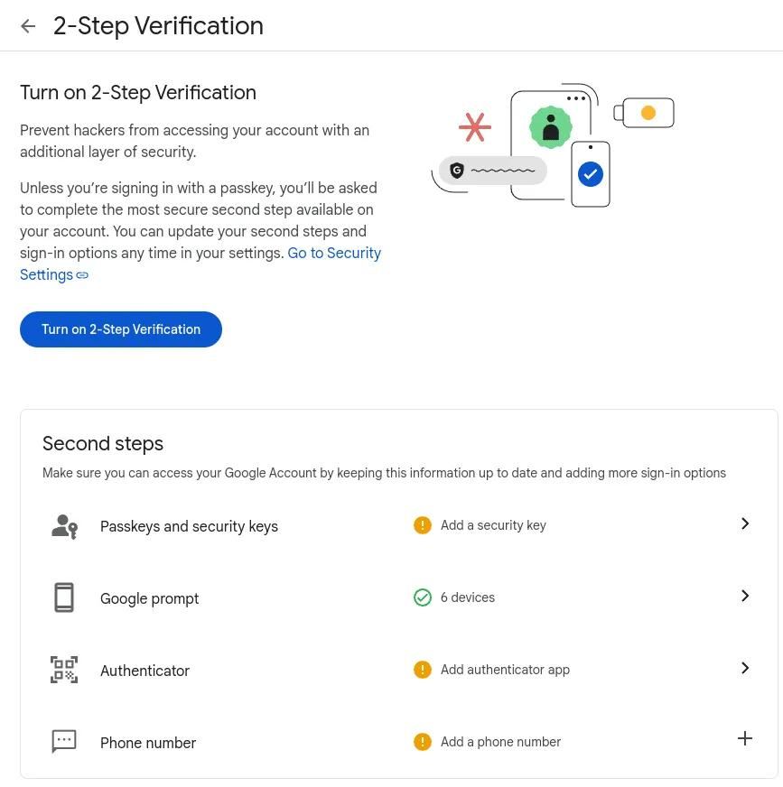
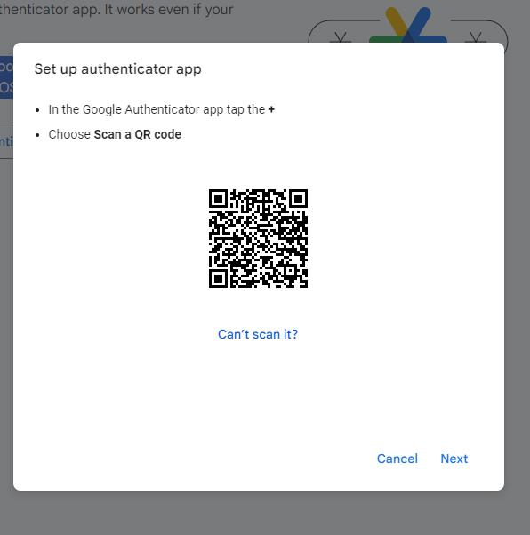
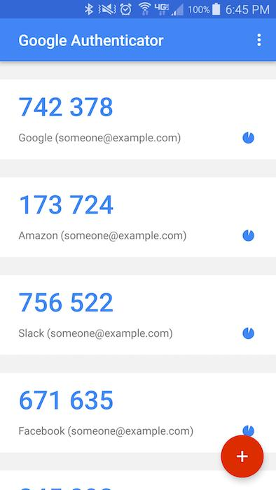
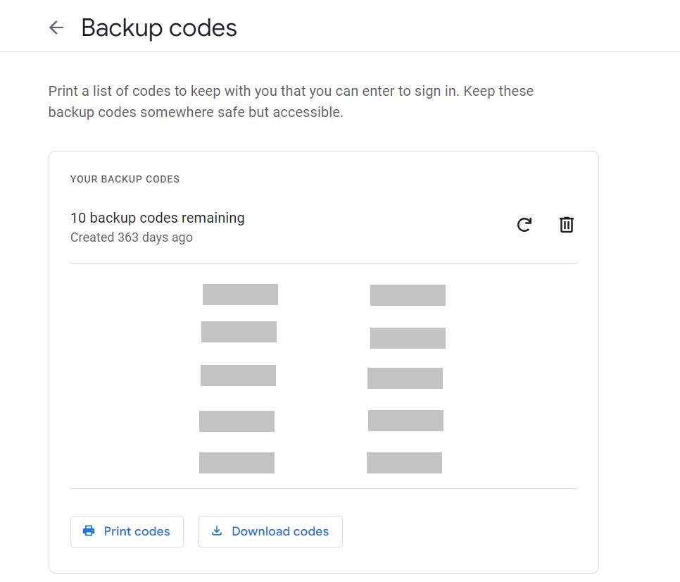
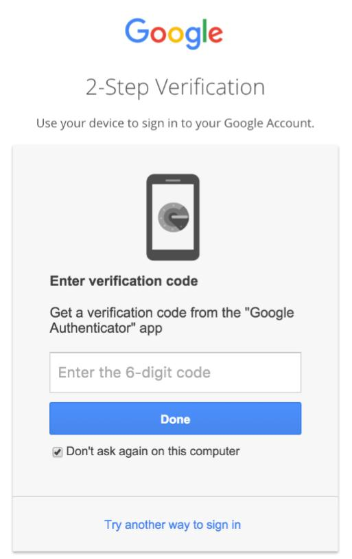

# NF1AA3 – Autenticació multifactor (MFA)

## Guia d'usuari: Configuració de Google Authenticator

**Activitat:** NF1AA3 – Autenticació multifactor  
**Objectiu:** Millorar la seguretat dels comptes corporatius mitjançant la verificació en dos passos.

---

## 1. Introducció

L'autenticació multifactor (MFA) és un sistema de seguretat que afegeix una verificació extra quan iniciem sessió. A més de la contrasenya, necessitem un segon mètode, com un codi temporal generat des del mòbil.

Això ajuda a evitar que altres persones puguin entrar al nostre compte sense permís.

## 2. Requisits necessaris

Per començar necessitem:

- Un ordinador amb connexió a Internet.
- Un mòbil Android o iOS.
- Un compte corporatiu de Google (`mataro.epiaedu.cat`).
- L'aplicació Google Authenticator instal·lada.

## 3. Instal·lació de Google Authenticator

**Pas 1.** Entrem a la botiga d'aplicacions del nostre mòbil:

- Android: [Google Play](https://play.google.com/store/apps/details?id=com.google.android.apps.authenticator2).
- iPhone: [App Store](https://apps.apple.com/app/google-authenticator/id388497605).

**Pas 2.** Cerquem Google Authenticator, l'instal·lem i obrim l'aplicació.

*Figura 1. Instal·lació de l'aplicació.*

## 4. Configuració de seguretat de Google

**Pas 1.** Obrim el navegador i iniciem sessió amb el compte corporatiu.

**Pas 2.** Accedim a [la configuració de seguretat de Google](https://myaccount.google.com/security).

**Pas 3.** Comprovem que tenim seleccionat el compte correcte i busquem l'apartat "Inici de sessió a Google".

*Figura 2. Configuració de seguretat del compte.*

## 5. Activació de la verificació en dos passos

**Pas 1.** Seleccionem l'opció "Verificació en dos passos".

**Pas 2.** Introduïm la contrasenya per confirmar la nostra identitat.

**Pas 3.** Seguim les instruccions que apareixen a Google per activar la verificació.

**Pas 4.** Vinculem el telèfon mòbil i busquem l'opció per configurar una aplicació d'autenticació.

*Figura 3. Activació de la verificació en dos passos.*

## 6. Vinculació amb Google Authenticator

**Pas 1.** A Google seleccionem "Aplicació Authenticator".

**Pas 2.** Apareixerà un codi QR a la pantalla de l'ordinador.

**Pas 3.** Obrim Google Authenticator, afegim un compte i seleccionem l'opció d'escanejar un QR.

**Pas 4.** Escanegem el codi amb la càmera del mòbil.

**Pas 5.** L'aplicació generarà codis de sis dígits. Introduïm el codi actual a Google per confirmar la vinculació.

*Figura 4. Connexió del compte mitjançant el codi QR.*

## 7. Comprovació dels codis

Després de configurar l'aplicació, ja podrem utilitzar els codis per verificar la nostra identitat.

1. Obrim Google Authenticator.
2. Busquem el compte corporatiu.
3. Consultem el codi de sis dígits.
4. L'introduïm quan Google ens ho demani.

Els codis canvien automàticament cada pocs segons, per tant, hem d'utilitzar sempre el que estigui actiu.

*Figura 5. Codis temporals de verificació.*

## 8. Creació de codis de seguretat

Aquests codis serveixen per recuperar l'accés al compte si no podem utilitzar el mòbil.

**Pas 1.** Tornem a l'apartat "Verificació en dos passos" de Google.

**Pas 2.** Entrem a "Codis de seguretat" i seleccionem generar codis.

**Pas 3.** Google ens proporcionarà deu codis diferents d'un sol ús.

**Pas 4.** Els descarreguem o imprimim i els guardem en un lloc segur.

**Important:** No hem de compartir aquests codis amb ningú.

*Figura 6. Generació dels codis de seguretat.*

## 9. Prova del funcionament de l'MFA

Per assegurar-nos que tot funciona correctament, farem una prova:

1. Tanquem la sessió de Google.
2. Tornem a entrar amb el correu i la contrasenya.
3. Google ens demanarà una segona verificació.
4. Seleccionem l'opció de l'aplicació d'autenticació.
5. Obrim Google Authenticator i introduïm el codi actual.

Si el codi és correcte, podrem accedir al compte.

*Figura 7. Inici de sessió amb autenticació multifactor.*

## 10. Recomanacions de seguretat

Per mantenir el compte protegit hem de seguir alguns consells:

- Utilitzar contrasenyes llargues i diferents.
- No compartir els codis de verificació ni el codi QR.
- Protegir el mòbil amb PIN o contrasenya.
- Guardar els codis de seguretat en un lloc protegit.
- No acceptar inicis de sessió que no haguem demanat.
- Avisar el responsable informàtic si perdem el mòbil.
- Mantenir actualitzats el sistema i l'aplicació.

## 11. Conclusions

Amb aquesta activitat hem après a configurar l'autenticació multifactor utilitzant Google Authenticator.

Aquest sistema afegeix una protecció extra als comptes, ja que no només necessitem la contrasenya, sinó també un segon mètode de verificació.

En conclusió, activar l'MFA és una bona manera de protegir la informació corporativa i evitar accessos no autoritzats.
